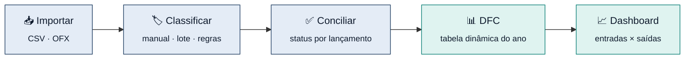
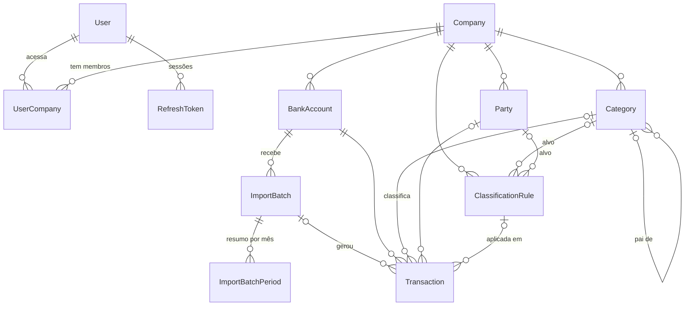
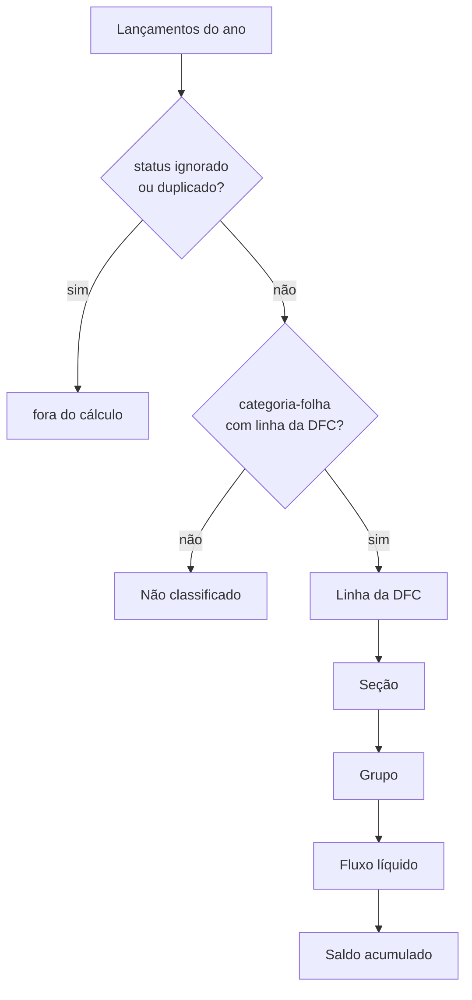
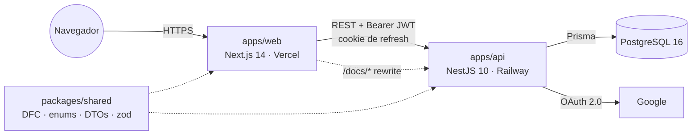
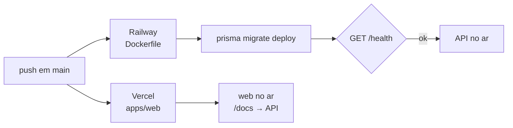

<div align="center">

<picture>
  <source media="(prefers-color-scheme: dark)" srcset="apps/web/public/brand/ledger-wordmark-white.svg">
  
</picture>

### Conciliação bancária inteligente, do extrato à DFC

Importe extratos CSV e OFX, classifique cada lançamento por regras e acompanhe a
Demonstração do Fluxo de Caixa do ano, mês a mês.

[](https://github.com/ordo-tecno/concilia-o/actions/workflows/ci.yml)


[**Manual interativo**](docs/manual/index.html) ·
[**Swagger**](#-documentação) ·
[**Regras de negócio**](#-o-que-o-app-faz) ·
[**Rodar local**](#-como-rodar-a-aplicação) ·
[**Deploy**](#-deploy) ·
[**Changelog**](docs/changes/CHANGELOG.md)

</div>

---

## ✦ O que o app faz

O Ledger mostra para onde vai e de onde vem o dinheiro de uma empresa, a partir
dos extratos bancários que ela já tem.



1. **Importar extratos.** O usuário envia um arquivo CSV ou OFX de uma conta
   bancária ativa. O sistema lê os lançamentos (data, descrição, valor) e ignora
   automaticamente o que já foi importado antes: mesma conta, data, valor e
   descrição, ou o mesmo identificador único do banco, no caso do OFX.
   Lançamentos idênticos dentro do mesmo extrato (ex: duas tarifas iguais no
   mesmo dia) são movimentações distintas e entram os dois. Linhas informativas
   de saldo ("SALDO ANTERIOR", "SALDO DO DIA"…) e lançamentos de valor zero não
   são movimentação: são descartados e contados como "ignorados". Um OFX cuja
   conta claramente não é a conta escolhida é recusado.
2. **Classificar cada lançamento.** Cada lançamento recebe uma categoria (ex:
   "Matéria-Prima", "Recebimentos de Clientes") e, opcionalmente, um fornecedor
   ou cliente. Isso pode ser feito à mão, em lote ou por regras (ex: "toda
   descrição que contenha 'ENERGISA' vai para Despesas Fixas"). A categoria vem
   da primeira regra ativa que bate e define categoria; o fornecedor/cliente,
   da primeira que bate e define um.
3. **Conciliar.** O usuário revisa a lista e marca o status de cada lançamento:
   pendente, conciliado, ignorado ou duplicado (identificado manualmente). O
   filtro "Sem categoria" é a fila do que falta classificar.
4. **Gerar a DFC.** Com os lançamentos classificados, o sistema monta a
   Demonstração do Fluxo de Caixa do ano, agrupada nas três áreas contábeis
   (Operacional, Investimento e Financiamento) e mês a mês.
5. **Visualizar no dashboard.** Gráficos com entradas, saídas e saldo ao longo
   do ano, e as categorias que mais movimentam.

> [!NOTE]
> **Multiempresa.** Um usuário pode ter acesso a mais de uma empresa, e todos os
> dados (contas, categorias, lançamentos, regras) pertencem a uma empresa
> específica. Nenhum dado de uma empresa pode referenciar o de outra.

---

## ✦ Definição das entidades

Campos técnicos internos (ids, `createdAt`/`updatedAt`) foram omitidos. Cada
campo é marcado como 🟦 **armazenado** (vem de uma ação do usuário ou do arquivo
importado) ou 🟩 **derivado** (calculado a partir de outros dados, nunca editado
diretamente).



<details>
<summary><b>🏢 Empresa</b> · <code>Company</code></summary>

Uma empresa/CNPJ para a qual o usuário conciliará movimentações. Todo dado
transacional (contas, categorias, lançamentos, regras, importações) pertence a
exatamente uma empresa.

| Campo | Tipo | Notas |
|---|---|---|
| nome | 🟦 | |
| CNPJ | 🟦 | opcional; gravado só com dígitos, com dígito verificador validado |

</details>

<details>
<summary><b>👤 Usuário e vínculo com empresa</b> · <code>User</code>, <code>UserCompany</code></summary>

Um usuário pode acessar várias empresas. `UserCompany.role` é hoje um texto
livre (`"ADMIN"`) e vira controle de permissões completo na Fase 2. O login pode
ser por e-mail/senha ou por Google, e a mesma pessoa pode ter os dois (a senha
fica nula em contas criadas só via Google). Um login Google com e-mail
verificado que já existe é vinculado à conta existente.

| Campo | Tipo | Notas |
|---|---|---|
| nome, e-mail | 🟦 | e-mail único |
| senha (hash) | 🟦 | opcional, nula em contas só-Google |
| `googleId` | 🟦 | opcional, único |
| avatar | 🟦 | opcional |
| papel na empresa | 🟦 | por vínculo |

</details>

<details>
<summary><b>🏦 Conta bancária</b> · <code>BankAccount</code></summary>

Uma conta bancária da empresa, para a qual os extratos são importados.

| Campo | Tipo | Notas |
|---|---|---|
| banco, agência, conta e dígito | 🟦 | |
| apelido | 🟦 | |
| ativa | 🟦 | |

**Regras:** conta inativa não recebe importações. Uma conta que já tem extratos
importados não pode ser excluída, porque a exclusão apagaria todo o histórico de
lançamentos dela. Desative-a.

</details>

<details>
<summary><b>🗂️ Categoria</b> · <code>Category</code></summary>

Uma árvore de categorias usada para classificar lançamentos. Categorias-pai
apenas agrupam (ex: "Despesas Operacionais"); só as categorias-folha recebem
lançamentos e precisam estar mapeadas a uma linha da DFC.

| Campo | Tipo | Notas |
|---|---|---|
| nome | 🟦 | |
| tipo | 🟦 | Receita, Despesa, Investimento, Financiamento |
| categoria-pai | 🟦 | opcional |
| linha da DFC | 🟦 | obrigatória nas folhas que recebem lançamentos, nula nas categorias-pai |
| ativa | 🟦 | |
| grupos, seções e subtotais da DFC | 🟩 | não são categorias: são calculados a partir do mapeamento categoria → linha da DFC ([`dfc-structure.ts`](packages/shared/src/dfc-structure.ts)) |

**Regras:**
- A linha da DFC precisa ser compatível com o tipo: Receita vai para as
  entradas operacionais, Despesa para as saídas operacionais, Investimento para
  o grupo Investimento e Financiamento para o grupo Financiamento.
- Uma folha que ganha a primeira subcategoria vira agrupadora e perde a linha da
  DFC. Por isso, isso só é permitido se ela ainda não tiver lançamentos nem
  regras apontando para ela.
- A categoria-pai precisa ser da mesma empresa, e mover uma categoria para baixo
  de uma das suas descendentes (ciclo) é recusado.
- A exclusão só é permitida sem subcategorias, lançamentos ou regras. Nos outros
  casos, desative a categoria: ela some das listas e o histórico fica.

</details>

<details>
<summary><b>🤝 Fornecedor/Cliente</b> · <code>Party</code></summary>

Uma pessoa ou empresa com quem a empresa transaciona.

| Campo | Tipo | Notas |
|---|---|---|
| nome | 🟦 | |
| documento | 🟦 | CNPJ/CPF, opcional e único por empresa; gravado só com dígitos, com dígito verificador validado |
| tipo | 🟦 | Fornecedor, Cliente ou Ambos |

</details>

<details>
<summary><b>📥 Importação de extrato</b> · <code>ImportBatch</code>, <code>ImportBatchPeriod</code></summary>

Registro de um upload de arquivo (CSV ou OFX) para uma conta bancária, guardado
junto com o conteúdo bruto do arquivo para auditoria.

| Campo | Tipo | Notas |
|---|---|---|
| origem | 🟦 | CSV ou OFX |
| nome e conteúdo original do arquivo | 🟦 | o conteúdo não sai na listagem do histórico |
| banco/agência/conta identificados no arquivo | 🟦 | |
| data e saldo de abertura/fechamento do extrato | 🟦 | abertura = saldo antes do 1º lançamento |
| status | 🟩 | processando → concluído / falhou |
| total, novos, duplicados, ignorados | 🟩 | total = novos + duplicados + ignorados; novos = efetivamente inseridos; duplicados = já existiam; ignorados = linhas de saldo e valores zero |
| por período (ano/mês): contagem, saldo de abertura e de fechamento | 🟩 | a contagem considera só o inserido naquele mês; os saldos vêm do extrato |

**Regras:** CSVs em ordem decrescente (mais recente primeiro) são reordenados
para ordem cronológica antes de calcular saldos. Valores aceitam os formatos
`-1.234,56`, `(1.234,56)`, `1.234,56-` e `1.234,56 D/C`. Uma data inexistente
(ex: 31/02) descarta a linha. A importação é atômica: uma falha não deixa
lançamento parcial.

</details>

<details>
<summary><b>💸 Lançamento</b> · <code>Transaction</code></summary>

Uma movimentação bancária e o núcleo do sistema. Cada linha de extrato vira um
lançamento.

| Campo | Tipo | Notas |
|---|---|---|
| data, data de liquidação | 🟦 | do arquivo; a liquidação, quando informada |
| descrição, histórico, documento | 🟦 | do arquivo |
| valor | 🟦 | positivo para crédito, negativo para débito |
| tipo | 🟦 | crédito/débito |
| saldo após o lançamento | 🟦 | quando o extrato informa |
| origem, `fitId` | 🟦 | `fitId` só em OFX |
| categoria, fornecedor/cliente | 🟦 | por ação do usuário ou do motor de regras |
| status de conciliação | 🟦 | pendente, conciliado, ignorado, duplicado |
| origem da classificação, regra aplicada | 🟦 | manual ou por regra |
| ano e mês de competência | 🟩 | extraídos da data do lançamento |
| hash de deduplicação | 🟩 | conta + data + valor + descrição normalizada + ordem da ocorrência dentro do extrato |

**Regras:** a categoria atribuída (à mão, em lote ou por regra) tem de ser uma
categoria-folha ativa da mesma empresa, mapeada a uma linha da DFC. O
fornecedor/cliente também tem de ser da mesma empresa. Remover a categoria limpa
também a origem da classificação. Lançamentos ignorados ou duplicados não entram
na DFC nem no dashboard.

</details>

<details>
<summary><b>⚙️ Regra de classificação</b> · <code>ClassificationRule</code></summary>

Uma regra que classifica lançamentos automaticamente. As regras ativas de uma
empresa são avaliadas em ordem de prioridade (maior primeiro, desempate pela
mais antiga), campo a campo:

- a **categoria** vem da primeira regra que bate e define categoria;
- o **fornecedor/cliente** vem da primeira regra que bate e define um, e só se o
  lançamento ainda não tiver um. O motor nunca sobrescreve o que o usuário
  escolheu.

Por isso, uma regra só de fornecedor não impede que uma regra de categoria de
prioridade menor classifique o lançamento. O motor só considera lançamentos
pendentes e sem categoria. As regras são aplicadas automaticamente logo após
cada importação (apenas nos lançamentos recém-inseridos) e sob demanda pelo
botão "Reaplicar em pendentes". Os tipos "Contém" e "Igual" comparam sem
diferenciar maiúsculas, acentos e espaços repetidos; "Regex" usa o texto
original, sem diferenciar maiúsculas.

| Campo | Tipo | Notas |
|---|---|---|
| nome | 🟦 | |
| campo comparado | 🟦 | descrição, histórico ou documento |
| tipo de comparação | 🟦 | contém, igual ou regex (regex inválida é recusada ao salvar) |
| padrão | 🟦 | |
| categoria e/ou fornecedor/cliente | 🟦 | pelo menos um, com as mesmas restrições da classificação manual |
| prioridade, ativa | 🟦 | |

</details>

<details>
<summary><b>📊 DFC</b> · Demonstração do Fluxo de Caixa (não armazenada)</summary>

**A DFC não é uma entidade armazenada.** Ela é inteiramente derivada, calculada
sob demanda a partir dos lançamentos classificados de um ano. Lançamentos
marcados como ignorados ou duplicados não entram (nem no dashboard). Cada
lançamento soma o seu valor na linha da DFC mapeada pela sua categoria; grupos,
seções e subtotais (Operacional, Investimento e Financiamento) são somas dessas
linhas, definidas em código em
[`packages/shared/src/dfc-structure.ts`](packages/shared/src/dfc-structure.ts).

O saldo inicial e o final são o acumulado do fluxo de caixa classificado dentro
do ano selecionado, começando de zero. **Não** são o saldo bancário real da
conta, que exigiria snapshots de todas as contas ao longo dos anos e está fora
do escopo do MVP. Isso é indicado explicitamente na tela. O fluxo ainda não
classificado (sem categoria ou em categoria sem linha da DFC) aparece numa linha
à parte, "Não classificado", fora dos grupos e dos saldos, com atalho para a
grade filtrada, para a DFC nunca parecer completa quando não está. Os valores
são arredondados ao centavo.



</details>

---

## ✦ Documentação

| | Onde | O que tem |
|---|---|---|
| 📘 **Manual interativo** | `GET /docs/ledger-manual` · [`docs/manual/index.html`](docs/manual/index.html) | arquitetura, diagramas clicáveis, simuladores de importação, regras e DFC, referência da API |
| 🧪 **Swagger** | `GET /docs/api` · JSON em `/docs/api-json` | todas as rotas com os schemas dos DTOs; autentique com o Bearer token |
| 🗺️ **Varredura de regras** | [`docs/review-2026-10-scan.md`](docs/review-2026-10-scan.md) | achados corrigidos e plano dos pendentes (P1–P11) |
| ⚡ **Requisitos não-funcionais** | [`docs/non-functional-requirements.md`](docs/non-functional-requirements.md) | metas de escala e volume |
| 📜 **Changelog** | [`docs/changes/CHANGELOG.md`](docs/changes/CHANGELOG.md) | uma entrada por mudança média ou maior |

A API serve as duas páginas publicamente. No web, o Next faz rewrite de
`/docs/*` para a API, então elas abrem no domínio principal (ex:
`https://ledgercompany.com.br/docs/ledger-manual`). Para esconder num ambiente,
use `DOCS_ENABLED=false`.

---

## ✦ Arquitetura



| Camada | Stack |
|---|---|
| **Frontend** | Next.js 14 (App Router), TypeScript, Tailwind CSS, shadcn/ui, TanStack Table/Query, Recharts |
| **Backend** | NestJS, TypeScript, Prisma, `@nestjs/throttler`, `@nestjs/swagger` |
| **Banco** | PostgreSQL 16 (Docker Compose no ambiente local, porta 55432) |
| **Auth** | e-mail/senha ou Google (OAuth); JWT de acesso em memória + refresh token em cookie httpOnly, rotacionado com detecção de reuso |

<details>
<summary><b>Estrutura do monorepo</b></summary>

```
apps/api        NestJS: módulos de domínio em src/modules/*, regras de
                atribuição em src/common/domain, e2e em test/
apps/web        Next.js App Router: páginas em app/(auth) e app/(app)
packages/shared Enums, DTOs, validação (zod), CPF/CNPJ e a hierarquia da DFC,
                fonte única de verdade usada pelo backend e pelo frontend
docs/           manual interativo, changelog, varredura, NFRs e fases
```

</details>

---

## ✦ Como rodar a aplicação

**Pré-requisitos:** Node 20 ou superior (`node -v`), Docker Desktop aberto
(`docker ps`) e Git.

```bash
# 1. dependências (um único node_modules na raiz)
npm install

# 2. banco: Postgres na porta 55432, para não conflitar com um nativo na 5432
npm run docker:up

# 3. variáveis de ambiente (os valores de desenvolvimento já funcionam)
cp .env.example apps/api/.env
echo "NEXT_PUBLIC_API_URL=http://localhost:3001" > apps/web/.env.local

# 4. tabelas + dados de exemplo (empresa demo e árvore de categorias da DFC)
npm run prisma:migrate
npm run prisma:seed

# 5. shared (watch) + API :3001 + web :3000
npm run dev
```

Abra **http://localhost:3000** e entre com `demo@conciliacao.dev` / `demo12345`.
O usuário demo já vem com a "Empresa Demo Ltda", uma conta bancária e o plano de
categorias mapeado à DFC, então dá para importar um extrato e ver a DFC na hora.

> [!IMPORTANT]
> A API **recusa subir** se faltar `JWT_ACCESS_SECRET`, `JWT_REFRESH_SECRET`,
> `DATABASE_URL` ou `CORS_ORIGIN`. Não pule o passo 3.

| Serviço | URL | Observação |
|---|---|---|
| Web | http://localhost:3000 | onde você usa o sistema |
| API | http://localhost:3001/health | deve responder `{ "status": "ok" }` |
| Manual | http://localhost:3001/docs/ledger-manual | também em `localhost:3000/docs/ledger-manual` |
| Swagger | http://localhost:3001/docs/api | |
| pgAdmin | http://localhost:5050 | `admin@conciliacao.dev` / `admin` (só local) |

<details>
<summary><b>Login com Google em ambiente local (opcional)</b></summary>

O login por e-mail e senha funciona sem configuração extra. Para testar o
**"Continuar com Google"**, preencha no `apps/api/.env`:

```env
GOOGLE_CLIENT_ID="..."         # do Google Cloud Console
GOOGLE_CLIENT_SECRET="..."
GOOGLE_CALLBACK_URL="http://localhost:3001/auth/google/callback"
WEB_APP_URL="http://localhost:3000"
```

No Google Cloud Console, cadastre `http://localhost:3001/auth/google/callback`
como **Authorized redirect URI**. Depois de mexer no `.env`, reinicie o
`npm run dev`, porque a API só lê as variáveis no boot.

</details>

<details>
<summary><b>Problemas comuns</b></summary>

- **`docker ps` não funciona ou o banco não sobe:** o Docker Desktop não está
  aberto. Abra-o e rode `npm run docker:up` de novo.
- **A API não sobe por variável faltando:** você pulou o passo 3
  (`cp .env.example apps/api/.env`).
- **Porta 3000 ou 3001 ocupada:** feche a instância antiga do `npm run dev`.
- **404 em `_next/static/...` no front:** o `.next` do dev foi corrompido por um
  build de produção rodado junto. Pare o dev, apague `apps/web/.next` e rode
  `npm run dev` de novo.

</details>

### Comandos úteis

```bash
npm run build                                # shared → api → web
npm run docker:down                          # para os containers
npm run lint
npm --workspace=apps/api run test            # unitários (parsers, regras, DFC, guards…)
npm --workspace=apps/api run test:e2e        # e2e contra Postgres real
npm --workspace=apps/web run test            # api-client, toast, categorias
npm --workspace=apps/api run prisma:studio   # inspecionar o banco
```

> [!WARNING]
> Nunca rode `npm run build --workspace=apps/web` com o `next dev` da mesma
> pasta ativo. O build sobrescreve o `.next` do servidor de dev e quebra o hot
> reload (404 em `_next/static/...`). Se acontecer, pare o dev, apague
> `apps/web/.next` e rode `npm run dev` de novo.

---

## ✦ Deploy



<details>
<summary><b>API · Railway</b></summary>

O serviço usa o `Dockerfile` da raiz. As migrations rodam no start do container
(`prisma migrate deploy`) e o healthcheck é `GET /health`.

| Variável | Descrição |
|---|---|
| `DATABASE_URL` | connection string do PostgreSQL (plugin Railway Postgres) |
| `JWT_ACCESS_SECRET` | secret do access token (`openssl rand -hex 32`) |
| `JWT_REFRESH_SECRET` | secret do refresh token (`openssl rand -hex 32`) |
| `CORS_ORIGIN` | URL do app no Vercel (ex: `https://ledger.vercel.app`) |
| `NODE_ENV` | `production` (cookie de refresh `sameSite=none; secure`) |
| `GOOGLE_CLIENT_ID` / `GOOGLE_CLIENT_SECRET` | credenciais do Google Cloud Console |
| `GOOGLE_CALLBACK_URL` | `https://<railway-domain>/auth/google/callback` |
| `WEB_APP_URL` | URL do app no Vercel, destino do redirect pós-OAuth |
| `DOCS_ENABLED` | `false` esconde o manual e o Swagger (padrão: ligado) |
| `API_PUBLIC_URL` | URL pública da API para o "Try it out" do Swagger (opcional) |

`API_PORT` é opcional: o Railway injeta a porta via `$PORT`.

</details>

<details>
<summary><b>Web · Vercel</b></summary>

- **Root Directory:** `apps/web`
- **Framework Preset:** Next.js (build definido em `apps/web/vercel.json`)

| Variável | Descrição |
|---|---|
| `NEXT_PUBLIC_API_URL` | URL pública da API no Railway; também é o destino do rewrite de `/docs/*` |

O domínio do Vercel precisa estar registrado no Google Cloud Console como
`Authorized redirect URI` do OAuth client.

</details>

---

## ✦ Contribuindo

- **Commits pequenos**, uma mudança lógica por commit, no formato
  `type(module): descrição` (`feat` · `fix` · `chore`). Exemplos:
  `fix(dfc): exclui lançamentos duplicados do saldo acumulado`,
  `feat(imports): adiciona suporte a XLSX no parser`.
- Toda mudança média ou maior ganha um doc curto em
  [`docs/changes/`](docs/changes/TEMPLATE.md) e uma linha no
  [CHANGELOG](docs/changes/CHANGELOG.md).
- **Este README é a verdade atual das regras de negócio.** Se o código e o
  README divergirem, o README está errado e deve ser corrigido. Mudou uma regra,
  uma rota ou o modelo de dados? Atualize também o
  [manual](docs/manual/index.html).
- O roadmap de fases (IA de sugestão, RBAC, auditoria, Power BI…) está no
  [`CLAUDE.md`](CLAUDE.md) e em [`docs/dev-phases.md`](docs/dev-phases.md).

<div align="center"><sub>Ledger · conciliação bancária, classificação e DFC</sub></div>
